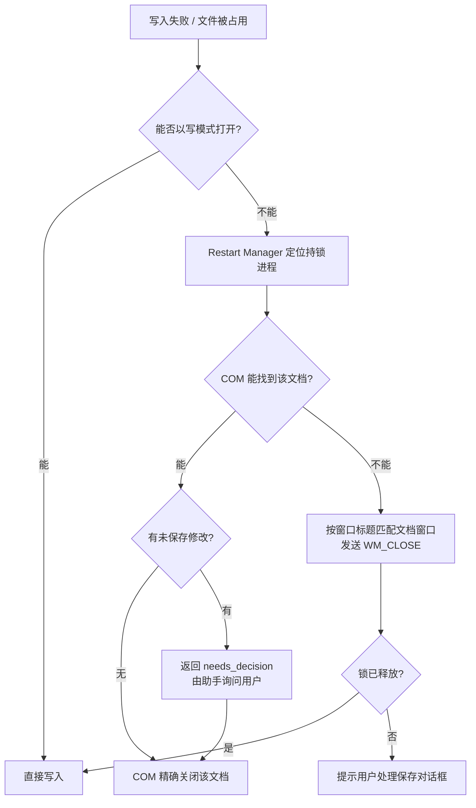

# unlock-file

**让 AI agent 在写文件失败时，自动解除 Windows 文件占用。**

一个按 [Agent Skills](https://agentskills.io) 开放格式组织的技能：当 AI 改 Excel / Word / WPS 文件时报 `PermissionError`、`[WinError 32]`、`另一个程序正在使用此文件`，它会定位占用进程并**优雅关闭**文档，然后重试写入——不静默丢数据，不无脑强杀。

> Windows 10 / 11 · Python 3.8+ · Excel / Word / WPS 均可
>
> 任何支持 Agent Skills 格式的客户端都可以加载；Claude Code 是其中之一。

---

## 痛点

```
PermissionError: [WinError 32] 另一个程序正在使用此文件，进程无法访问。
```

你让 AI 往台账里加两行，但你正好开着 Excel 或 WPS。AI 写不进去，你也得手动关窗口、再让 AI 重试。每次都要来回一轮。

这个技能把这一轮自动化掉。

## 特性

- **按需加载**：客户端根据 `description` 判断任务是否相关；是否自动调用由客户端决定
- **三层定位**：写锁检测 → Restart Manager 查持锁进程 → COM / 窗口消息精准关闭
- **WPS 适配**：处理 WPS 多进程架构（窗口进程 ≠ 持锁进程）的坑
- **数据安全**：关闭前能读到 `Saved` 状态；有未保存修改时拒绝擅自关闭，改为询问用户
- **零网络**：纯本地操作，不发任何请求、不上传任何内容

## 工作原理



| 步骤 | 使用的能力 | 作用 |
|---|---|---|
| 1. 检测 | `open(path, "a+b")` | 捕获共享冲突，判断是否被占用 |
| 2. 定位 | Restart Manager（`rstrtmgr.dll`） | 拿到持锁进程 PID 与应用名，WPS 子进程也能识别 |
| 3. 关闭 | COM（Excel/Word/WPS）/ `WM_CLOSE` | 优先精确关闭单个文档；COM 不可用时退化为点击 × 的等价操作 |

## 安装

### 前置要求

- Windows 10 / 11
- Python 3.8+（已在 PATH 中）
- 可选：`pywin32`（用于 COM 精确判断与关闭，缺失时自动退化为窗口消息）
  ```powershell
  python -m pip install pywin32
  ```

### 方式一：安装脚本

```powershell
git clone https://github.com/xiaohudasb/claude-skill-unlock-file.git
cd claude-skill-unlock-file
powershell -ExecutionPolicy Bypass -File .\install.ps1
```

默认安装到 Claude Code 的用户技能目录：

```text
%USERPROFILE%\.claude\skills\unlock-file
```

安装到其他 Agent Skills 客户端时，用 `-Dest` 指定该客户端的技能目录：

```powershell
powershell -ExecutionPolicy Bypass -File .\install.ps1 -Dest "C:\path\to\skills\unlock-file"
```

`-Dest` 的最后一级目录必须是 `unlock-file`，因为 Agent Skills 规范要求技能名与父目录同名。

### 方式二：手动安装

以 Claude Code 为例：

```powershell
git clone https://github.com/xiaohudasb/claude-skill-unlock-file.git
$dest = "$env:USERPROFILE\.claude\skills\unlock-file"
New-Item -ItemType Directory -Force -Path $dest | Out-Null
Copy-Item -Recurse -Force .\claude-skill-unlock-file\unlock-file\* $dest
```

其他客户端：把仓库里的 `unlock-file` 文件夹整个复制到该客户端的技能目录，并确保文件夹名是 `unlock-file`。不同客户端使用不同的技能目录，具体位置请查阅对应客户端文档。

安装后重新打开客户端会话；是否自动出现在可用技能列表中，由客户端实现决定。

## 使用

### 在 Agent Skills 客户端中

支持自动加载的客户端会在任务匹配时读取本技能；不支持自动加载的客户端需要你手动触发，或把技能内容加入对话。核心命令相同，**在 `SKILL.md` 所在目录执行**：

```bash
python scripts/unlock_file.py "D:/项目/台账.xlsx" --json
```

例如在 Claude Code 中，技能通常位于 `~/.claude/skills/unlock-file`：

```bash
cd "$HOME/.claude/skills/unlock-file"
python scripts/unlock_file.py "D:/项目/台账.xlsx" --json
```

也可以直接说：

> 「台账被 WPS 占用了，帮我关掉再写」

### 命令行

以下命令在仓库根目录执行：

```bash
# 默认：检测 + 优雅关闭
python unlock-file/scripts/unlock_file.py "D:/项目/台账.xlsx" --json

# 只检测，不关闭任何文件
python unlock-file/scripts/unlock_file.py "D:/项目/台账.xlsx" --no-close --json

# 有未保存修改时保存后关闭（仅 COM 路线有效）
python unlock-file/scripts/unlock_file.py "D:/项目/台账.xlsx" --save --json

# 强杀占用进程（最后手段，未保存修改会丢失）
python unlock-file/scripts/unlock_file.py "D:/项目/台账.xlsx" --force-kill --json
```

| 参数 | 说明 |
|---|---|
| `--json` | 输出机器可读 JSON |
| `--no-close` | 只检测，不执行任何关闭动作 |
| `--save` | 文档有未保存修改时先保存再关闭 |
| `--force-kill` | `taskkill /F` 结束占用进程（危险，需人工确认） |

### 输出与退出码

```json
{
  "file": "D:\\项目\\台账.xlsx",
  "status": "closed",
  "locked": false,
  "lock_files": ["D:\\项目\\~$台账.xlsx"],
  "owners": [
    { "pid": 13624, "process": "et.exe", "app": "WPS Spreadsheets" }
  ],
  "message": "已关闭文档窗口（若弹出过保存提示，说明已按提示处理）",
  "actions": ["WM_CLOSE -> 台账.xlsx - WPS Office"]
}
```

| 退出码 | 含义 |
|---|---|
| `0` | 未被占用 / 已成功解除 |
| `2` | 需要用户决定（有未保存修改，或弹出了保存对话框） |
| `3` | 被占用但无法安全自动解除 |
| `1` | 脚本或环境错误 |

### status 对照

| status | 含义 | 建议处理 |
|---|---|---|
| `not_locked` | 未被占用 | 直接重试写入 |
| `closed` | 已关闭，锁已释放 | 重试写入 |
| `needs_decision` | 有未保存修改 | 询问用户：保存并关闭 / 放弃修改 / 取消 |
| `needs_save_confirm` | 已请求关闭但仍锁着 | 让用户在应用里点「保存 / 不保存」 |
| `locked_unknown` | 找不到可关闭的窗口 | 报告进程；确认后再考虑 `--force-kill` |
| `locked` | `--no-close` 的检测结果 | 仅参考 |
| `not_found` | 路径不存在 | 核对路径 |

## 安全设计

这是本技能最看重的部分——**它操作的是你正在编辑的文档**：

1. **默认只做优雅关闭**：发送 `WM_CLOSE`，等价于点右上角 ×。应用自己决定是否弹保存提示，不会静默丢弃修改。
2. **有修改不擅自动手**：COM 能读到 `Saved == False` 时，脚本直接返回 `needs_decision`，由助手询问你。
3. **强杀需明确授权**：`--force-kill` 不会自动使用。
4. **不删除 `~$` 锁文件**：应用运行时删锁文件可能损坏文档，脚本只报告。
5. **不碰无关进程**：窗口匹配要求标题含目标文件名，且限制在已知 Office/WPS 窗口类；定位不到就停下报告。

## 兼容性

### 客户端

| 客户端 | 说明 |
|---|---|
| Claude Code | `install.ps1` 默认安装到 `%USERPROFILE%\.claude\skills\unlock-file`；技能会自动加载 |
| 其他支持 Agent Skills 的客户端 | 把 `unlock-file/` 复制到该客户端的技能目录；是否自动触发由客户端决定 |

### 系统与应用

| 项目 | 支持情况 |
|---|---|
| Windows 10 / 11 | ✅ 已测试 |
| Microsoft Excel / Word / PowerPoint | ✅ COM 路线 |
| WPS 表格 / 文字 / 演示 | ✅ 已测试（COM + 窗口消息双路线） |
| 其他占用文件的程序 | ⚠️ 能定位并报告进程，无法自动关闭 |
| macOS / Linux | ❌ 依赖 Windows API（Restart Manager / `WM_CLOSE`） |

> 开发环境：Windows 11 26200、WPS Office、Python 3.x、pywin32。不同 Office 版本的对象模型可能存在细微差异，欢迎提 Issue。

## 已知限制

- **保存对话框需要人工确认**：文档有未保存修改且 COM 不可达时，WPS/Office 会弹窗等待点击，脚本只能提示你处理。
- **WPS 的 COM 不稳定**：WPS 常常不注册到 ROT，`GetActiveObject` 会失败；此时自动退化为窗口消息路线（仍安全，但无法提前判断修改状态）。
- **云文档 / 同步盘**：OneDrive、WPS 云文档可能在关闭后重新加锁。
- **同名的多个窗口**：按标题匹配可能选中另一个同名文档，使用前请确认目标路径唯一。

## 目录结构

```
claude-skill-unlock-file/
├── unlock-file/
│   ├── SKILL.md              # Agent Skill 说明（触发条件、安全规则、工作流）
│   └── scripts/
│       └── unlock_file.py    # 检测与解除占用脚本
├── README.md
├── LICENSE
├── .gitignore
└── install.ps1               # Windows 安装脚本
```

## 开发与测试

```bash
# 1. 造一个被占用的测试文件
python -c "import openpyxl; w=openpyxl.Workbook(); w.save('test.xlsx')"
powershell -c "Start-Process test.xlsx"    # 用 WPS/Excel 打开

# 2. 只检测
python unlock-file/scripts/unlock_file.py test.xlsx --no-close --json    # 期望 exit=3, status=locked

# 3. 解除
python unlock-file/scripts/unlock_file.py test.xlsx --json               # 期望 exit=0, status=closed

# 4. 验证可写
python -c "import openpyxl; w=openpyxl.load_workbook('test.xlsx'); w.save('test.xlsx')"
```

## English

A portable Agent Skill for Windows that automatically releases file locks (Excel / Word / WPS) before an AI agent edits a file. It detects the lock, identifies the owning process via the Windows Restart Manager, and gracefully closes only the target document window. Unsaved changes are never discarded silently: the tool reports `needs_decision` so the user can choose. Force-kill is opt-in only. No network access.

It follows the [Agent Skills](https://agentskills.io) open format (`SKILL.md` plus optional scripts) and can be loaded by any compatible client. Claude Code is one supported client.

Install with `install.ps1` (defaults to Claude Code's `%USERPROFILE%\.claude\skills\unlock-file`), or copy the `unlock-file/` folder into your client's skills directory. The folder must be named `unlock-file`.

## License

[MIT](LICENSE)

---

如果这个技能帮你省了几次「关窗口再重试」，欢迎点个 ⭐。